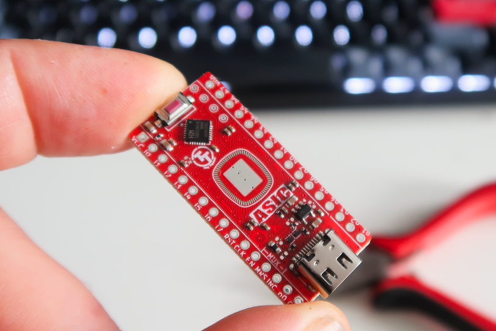
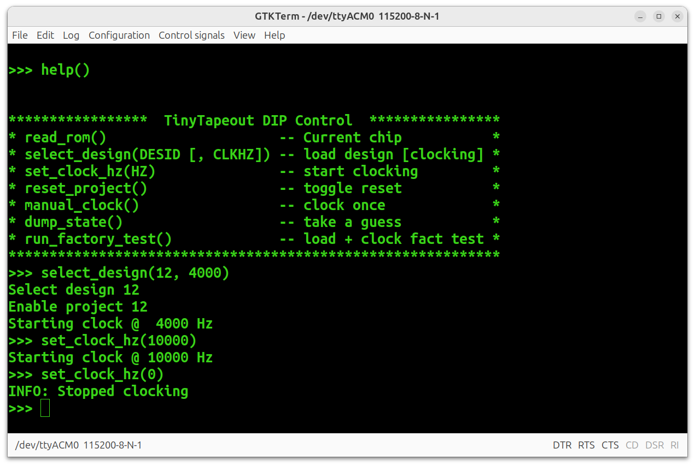
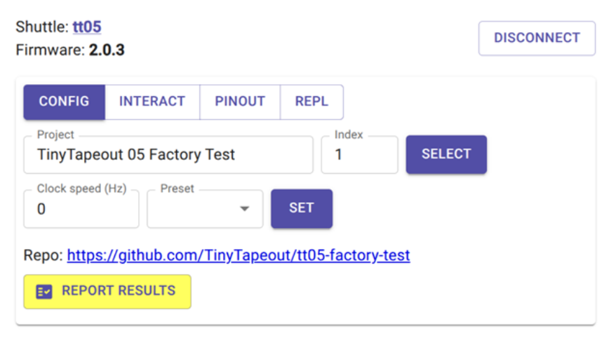
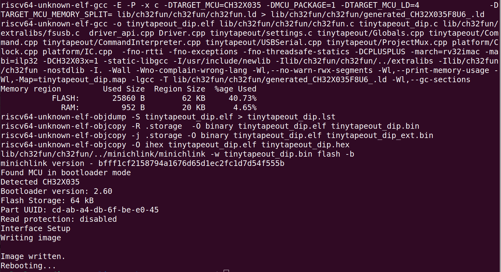

# Tiny Tapeout DIP firmware

The TT DIP is a breakout for Chip on Board (CoB) ASICs that lets you drop in the ASIC to a breadboard or circuit.



It offers 2 modes:

  1) Passive breakout for Tiny Tapeout Multi-project ASIC; and
  2) Auto-configured to act as a breakout for a selected project
  

  
## Multi-project ASIC

In this mode, *you* get to control the ASIC MUX and select the project, by controlling the multiplexer pins.

In addition, all the I/O, clock and reset are available to you to interact with the project.

There are two ways to get this working:
  1) using Bootup Autodetection, described below 
  2) by hard-coding these settings 

To have the board always behave in this manner, simply edit [projectselect.h](src/projectselect.h) and set:

```
/* MUX is controlled by you, through pins */
#define TT_DIP_MUX_EXTERNALLY_DRIVEN			1

/* clocking and reset are controlled by you, through pins */
#define TT_DIP_CLOCK_AND_RESET_EXTERNALLY_DRIVEN	1
```

See below for information on building new firmware.

## Auto-selected Design

You may also set things up to automatically select a particular project on the ASIC, optionally clocking it from the on-board MCU.  In this way, the breakout acts as a specific project right from power-up.

To enable this, you'll need to edit [projectselect.h](src/projectselect.h) to set the design ID (and, optionally, the rate at which to clock it, in Hz), e.g.

``` 
#define TT_DIP_DEFAULT_DESIGN_ID		42
#define TT_DIP_DEFAULT_CLOCK_HZ		25000
```

To auto-load project 42 and clock it at 25kHz.  You'll have to build new firmware, see the instructions on that below.


## Bootup Autodetection

Though settings defines in [projectselect.h](src/projectselect.h) let you specify whether the project clock/reset and project MUX are controlled externally, the `TT_DIP_AUTO_EXT_DRIVE_CHECK` define in the same file will enable autodetection functionality. 

The firmware will attempt to automatically detect if an external circuitry is driving the chip, for both the project MUX and project clock/reset.  When enabled, this will:

  * set both the project clock and MUX increment pins to inputs with a pull-up 
  * check if either of the pins is actively driven LOW
  
If the project clock is read LOW, the system will assume the project CLOCK and RESET lines are controlled externally, and will not drive them.  In this case, it will refuse any attempts to auto-clock or reset the project from the MCU (until power cycling).

If the MUX increment pin is read LOW, the system determines that the project MUX is controlled externally.  From that point, it will avoid playing with any of the 3 project MUX pins and it will be up to external circuits to select projects from the ASIC.


To disable this check, set `TT_DIP_AUTO_EXT_DRIVE_CHECK` to 0 in [projectselect.h](src/projectselect.h).

## Factory Test

All the ASICs have a built-in factory test.  The firmware allows this project to be activated, regardless of what the auto-selected design settings are.

By default, if you've configured `TT_DIP_DEFAULT_DESIGN_ID`, that project will be loaded on powerup.  However, when the `TT_DIP_RST_FACTORY_TEST_CHECK` define is `1` in [projectselect.h](src/projectselect.h) (as it is by default), holding the project reset line LOW on powerup will select and clock the factory reset test (assuming the project clock and MUX aren't externally driven).


## TUI

A serial port is available through the USB-C connector.



This allows you to select designs, set the clock rate, etc.

### Commander

In addition, this should allow control through the [Tiny Tapeout commander](https://commander.tinytapeout.com/) interface, right in the browser.




# New firmware

Whether to auto-configure a specific design or tweak other behaviour, you may need to build a new system.  

This software relies heavily on the awesome [ch32fun](https://github.com/cnlohr/ch32fun) library.  You have everything you need to build a working system here, but see the [ch32fun installation instructions](https://github.com/cnlohr/ch32fun/wiki/Installation) for details on installing the tooling for you computron. 

If you have all that, create and burn new firmware:

 1) ensure you have submodules, doing `git submodule update --init --recursive`
 
 2) you probably want to edit [projectselect.h](src/projectselect.h) to set `TT_DIP_DEFAULT_DESIGN_ID` (default design to load) and `TT_DIP_DEFAULT_CLOCK_HZ` or other defines described above
 
 3) **hold** the BOOT button as prior to and during insertion into USB port and release once inserted
 
 4) From the src directory, issue `make` which will both build and burn the new firmware
 
You should see something like


This assumes your user can access the USB device that shows up.  Under Linux, I added a rule like

```
SUBSYSTEM=="usb", ATTR{idVendor}=="1a86", ATTR{idProduct}=="55e0", GROUP="plugdev", OWNER:="myuser", SYMLINK+="wchlink-%k", TAG+="uaccess"
```

Even so, there are occasions where the process fails to complete.  meh.  Recipe so far is just to unplug and try again.


# Development

Some notes if you want to modify or extend the firmware.

## Architecture

The `main()` function is in a pure C file, [tinytapeout_dip.c](src/tinytapeout_dip.c), and pretty much everything else is C++ and is relatively simple.

Most the configuration options you set using #defines as described above are actually held in a mutable [Settings struct](src/includes/settings.h#L33), accessible to the code.

The code uses [ch32fun](https://github.com/cnlohr/ch32fun) on a CH32X035 chip to provide the USB serial TUI and handle project selection and control, hiding most of the ch32 stuff within `Platform::IC` ([IC.h](src/includes/platform/IC.h)) and `Platform::Clock` ([Clock.h](src/includes/platform/Clock.h)).

Tiny Tapeout specifics are mostly related to the ASIC MUX, and the `TinyTapeout::ProjectMux` class ([ProjectMux.h](src/includes/ProjectMux.h)) handles the details on that front.  `TinyTapeout::Driver` is the main entry point into the system ([Driver.h](src/includes/Driver.h)), handling initialization, auto-detections, and being `tick()`ed to handle commands coming in from the USB serial, using the `TinyTapeout::CommandInterpreter` ([CommandInterpreter.h](src/includes/CommandInterpreter.h)).

All the functionality of the commands is just in a big switch in the `TinyTapeout::Command` ([Command.h](src/includes/Command.h)) [execute() method](src/tinytapeout/Command.cpp#L89).

## Desktop Dev

To ease and speed up development, it's possible to run the firmware on the desktop (at least under linux, and probably anything that supports make and ncurses) to interact with the TUI live and use gdb.

To build it, you just need to 

```
cd src
make -f test.mk clean
make -f test.mk 
```

Then run `./test`.  Issue a `?` to see the menu of available commands and issue whatever you like, eg

```
select_design(3, 1000000)
dump_state()
dump_settings()
```

## Debug Output

You'll find the code strewn with calls to `USBSerial::outputInfo()`, `USBSerial::outputDebug()` etc.  This output will go to the terminal according to the level set by the `USBSERIAL_DEBUG_LEVEL` (default set in [TTDIPconfig.h](src/includes/TTDIPconfig.h), but may be overidden during build as it is in [test.mk](src/test.mk#L7)).


# Copyright and License

This firmware is 
```
Copyright (C) 2026 Pat Deegan, [psychogenic.com](https://psychogenic.com)
```
and released under the terms of the [GNU GPL v3](https://www.gnu.org/licenses/gpl-3.0.en.html). See the LICENSE file for details.

